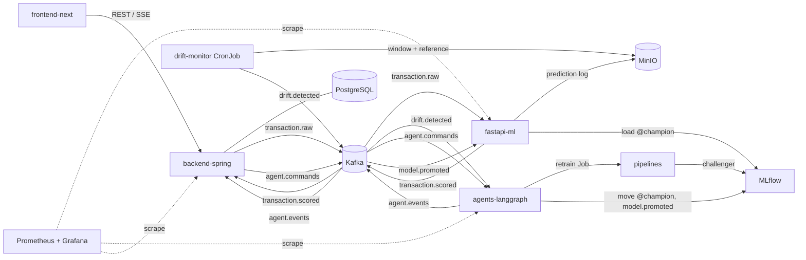

# Infinity MLOps

[](https://github.com/toubani12/infinity-mlops/actions/workflows/ci.yml)
[](https://github.com/toubani12/infinity-mlops/actions/workflows/e2e-kind.yml)
[](https://github.com/toubani12/infinity-mlops/actions/workflows/build-images.yml)

Self-healing MLOps platform for real-time bank fraud detection.

Transactions are scored as they arrive. A drift monitor compares recent predictions with the reference data, and when quality degrades a LangGraph agent retrains the model, compares the challenger with the production champion and asks a human to approve the promotion. Nothing reaches production without that approval.

## Architecture



| Component | Stack | Path |
|---|---|---|
| backend-spring | Spring Boot 3, Java 21, PostgreSQL | [`apps/backend-spring`](apps/backend-spring/README.md) |
| fastapi-ml | FastAPI, Python 3.12, XGBoost | [`apps/fastapi-ml`](apps/fastapi-ml/README.md) |
| frontend-next | Next.js App Router, TypeScript | [`apps/frontend-next`](apps/frontend-next/README.md) |
| drift-monitor | Evidently, Kubernetes CronJob | [`services/drift-monitor`](services/drift-monitor/README.md) |
| agents-langgraph | LangGraph, Python 3.12 | [`services/agents-langgraph`](services/agents-langgraph/README.md) |
| pipelines | XGBoost, scikit-learn, MLflow | [`pipelines`](pipelines/README.md) |
| platform | Kafka KRaft, MLflow, MinIO, PostgreSQL, Prometheus, Grafana, Kustomize | `infra`, `k8s` |

Services talk through Kafka topics whose JSON Schemas live in [`libs/contracts`](libs/contracts/README.md). Details: [architecture overview](docs/architecture/overview.md), [runtime conventions](docs/architecture/runtime-conventions.md) (ports, environment variables, buckets), [retrain contract](docs/architecture/retrain-contract.md).

## Quick start

Needs Docker with Compose v2, `uv`, and about 8 GB of free memory.

```bash
git clone git@github.com:toubani12/infinity-mlops.git && cd infinity-mlops
git config core.hooksPath .githooks

make up                      # Kafka, PostgreSQL, MinIO, MLflow, buckets and topics

# first champion: ingest data/creditcard.csv (synthetic data when absent) and train
cd pipelines
export MLFLOW_TRACKING_URI=http://localhost:5000 MLFLOW_S3_ENDPOINT_URL=http://localhost:9000 \
  S3_ENDPOINT_URL=http://localhost:9000 AWS_ACCESS_KEY_ID=minio AWS_SECRET_ACCESS_KEY=minio12345
uv run python -m data.ingest --dest s3://datasets/raw/creditcard.parquet
uv run python -m training.train --data s3://datasets/raw/creditcard.parquet --bootstrap-champion
cd ..

make up-apps                 # backend, inference, dashboard, agent, drift-monitor, Prometheus, Grafana
make seed                    # demo transactions through the backend
```

Then open the dashboard at http://localhost:3000, Grafana at http://localhost:3001 and MLflow at http://localhost:5000. The guided demo is in [docs/runbooks/demo.md](docs/runbooks/demo.md).

The full loop (retrain Job, approval, promotion) needs Kubernetes:

```bash
make minikube                # MINIKUBE_CNI=calico to enforce the network policies
make e2e-demo                # weak champion, scored transactions, drift alert, approval, promotion
```

## Documentation

| Topic | Where |
|---|---|
| Local stack, ports, troubleshooting | [docs/runbooks/local-stack.md](docs/runbooks/local-stack.md) |
| Minikube, overlays, network policies | [docs/runbooks/minikube.md](docs/runbooks/minikube.md) |
| CI, images, kind end-to-end run | [docs/runbooks/ci.md](docs/runbooks/ci.md) |
| Metrics and Grafana | [docs/runbooks/observability.md](docs/runbooks/observability.md) |
| Demo scenario | [docs/runbooks/demo.md](docs/runbooks/demo.md) |
| Incident: drift.detected fired | [docs/runbooks/incident-drift.md](docs/runbooks/incident-drift.md) |
| Model rollback | [docs/runbooks/model-rollback.md](docs/runbooks/model-rollback.md) |
| Agent run stuck | [docs/runbooks/agent-stuck-run.md](docs/runbooks/agent-stuck-run.md) |
| Architecture decisions | [docs/adr](docs/adr/README.md) |
| Event contracts | [libs/contracts](libs/contracts/README.md) |
| Branches, commits, pull requests | [CONTRIBUTING.md](CONTRIBUTING.md) |

## Commands

| Command | Does |
|---|---|
| `make up` / `make up-apps` | infrastructure, then the application services and observability |
| `make ps`, `make logs s=<service>` | health and logs |
| `make down` / `make reset` | stop, or stop and delete the volumes |
| `make test`, `make lint` | tests and linters of every Python project, eslint on the dashboard |
| `make minikube` | minikube cluster, images built inside it, `k8s/overlays/minikube` applied |
| `make e2e-demo` | the short end-to-end scenario against the current cluster |
| `make k8s-validate` | render the Kustomize base and both overlays |

## Team

| Member | Role | Scope |
|---|---|---|
| Badr Eddine Toubani ([@toubani12](https://github.com/toubani12)) | Lead, platform and integration | contracts, infra, k8s, CI, agent, observability, docs |
| [@Agrigah](https://github.com/Agrigah) | Developer / MLOps engineer | pipelines, inference, drift, retrain job |
| [@mustapha005](https://github.com/mustapha005) | Full-stack / backend engineer | Spring API, dashboard, approval flow |

Master SDIA project, ENSET Mohammedia.
