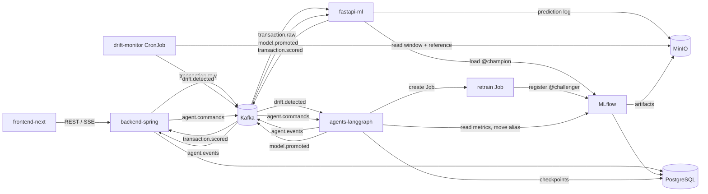

# Architecture overview

Six application components, one Kafka bus and three storage systems. Services talk through events. Two direct calls are deliberate: the dashboard calls the Spring backend over REST and SSE, and the inference service reads the MLflow registry to load the current model.

Ports, environment variables and bucket layout are in [runtime-conventions.md](runtime-conventions.md). Event schemas are in [`libs/contracts`](../../libs/contracts/README.md).

## Components

| Component | Technology | Owner | Role |
|---|---|---|---|
| frontend-next | Next.js App Router, TypeScript | mustapha005 | Transactions, alerts, drift, agent timeline, promotion approval |
| backend-spring | Spring Boot, Java 21, PostgreSQL | mustapha005 | Business entry point: transactions, alerts, relay of agent decisions |
| fastapi-ml | FastAPI, Python 3.12 | Agrigah | Scores each transaction, exposes `/predict`, logs predictions to MinIO |
| drift-monitor | Evidently, Kubernetes CronJob | Agrigah | Compares the current window with the reference set, publishes `drift.detected` |
| agents-langgraph | LangGraph, Python 3.12 | Badr | Qualifies the alert, launches retraining, requests approval, promotes or keeps the champion |
| pipelines | XGBoost, scikit-learn, MLflow | Agrigah | Ingestion, validation, training, evaluation, registration |
| platform | Kafka KRaft, MLflow, MinIO, PostgreSQL, Kustomize | Badr | Local stack, Kubernetes manifests, CI/CD |

## Event flow

| Topic | Producer | Consumers | Key | Retention |
|---|---|---|---|---|
| `transaction.raw` | backend-spring | fastapi-ml | `transaction_id` | 7 days |
| `transaction.scored` | fastapi-ml | backend-spring | `transaction_id` | 7 days |
| `drift.detected` | drift-monitor | agents-langgraph | `report_id` | 30 days |
| `agent.events` | agents-langgraph | backend-spring | `run_id` | 30 days |
| `agent.commands` | backend-spring | agents-langgraph | `run_id` | 30 days |
| `model.promoted` | agents-langgraph | fastapi-ml, backend-spring | `model_name` | 30 days |

## Self-healing loop

1. drift-monitor runs as a CronJob (hourly, every 5 minutes in the demo) and computes an Evidently report on the last prediction window against the reference set.
2. If more than 30 % of features drift, or PR-AUC on received labels drops by more than 5 points, it publishes `drift.detected`.
3. The agent qualifies the alert: noise, real drift or data incident (missing features, out-of-domain values). A data incident is escalated to a human without retraining.
4. For real drift the agent creates a Kubernetes Job from `k8s/jobs/retrain-job.yaml`. The resulting model is registered in MLflow with the alias `@challenger`.
5. Evaluation gate: the challenger must beat the champion on PR-AUC and recall at 90 % precision on recent data, with p95 latency under 50 ms.
6. The graph interrupts (LangGraph interrupt, state checkpointed in PostgreSQL) and publishes an approval request on `agent.events`. The dashboard shows both models' metrics.
7. On approval the agent moves `@champion` and publishes `model.promoted`; fastapi-ml reloads the model without restarting. On rejection or failure the champion stays and the reason is logged.

Agent guardrails: a closed tool list (read report, launch retrain Job, read MLflow metrics, request approval, move alias), a ServiceAccount that can only create Jobs in namespace `infinity`, one retrain at a time, and a rules-only mode used in CI.

## Storage

| Store | Content |
|---|---|
| PostgreSQL `infinity` | Transactions, alerts, agent run projections (backend) |
| PostgreSQL `mlflow` | MLflow tracking and registry |
| PostgreSQL `agent` | LangGraph checkpoints |
| MinIO `mlflow` | Model artifacts |
| MinIO `datasets` | Raw dataset and drift reference sample |
| MinIO `predictions` | Hourly Parquet prediction log |
| MinIO `drift-reports` | Evidently HTML and JSON reports |
